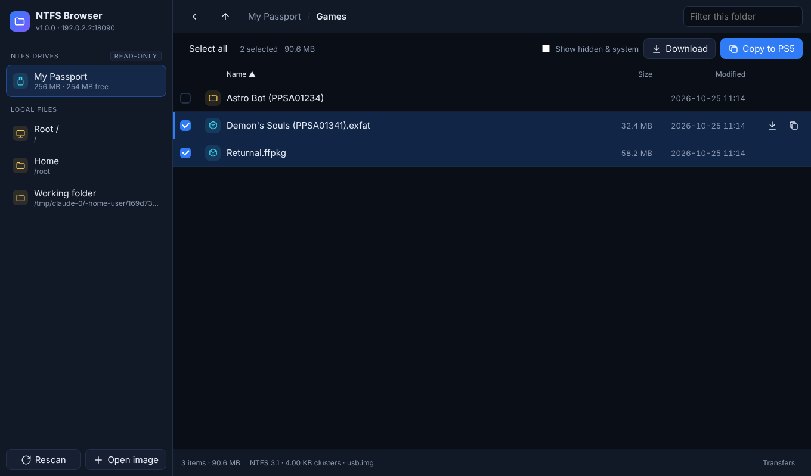
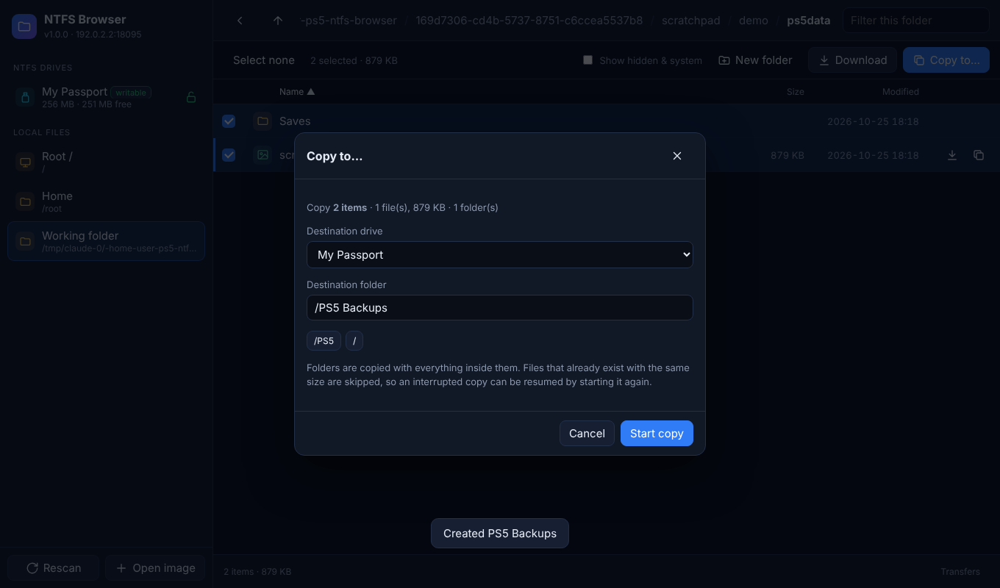
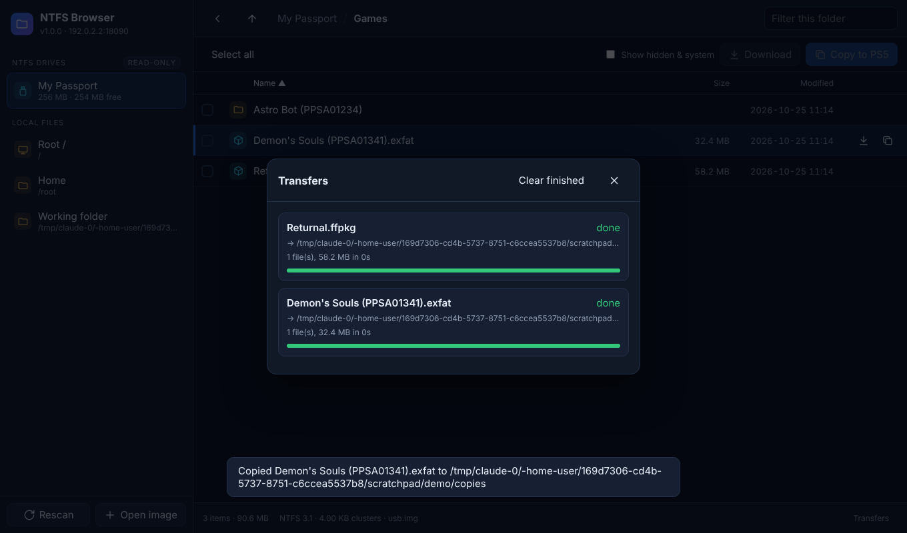
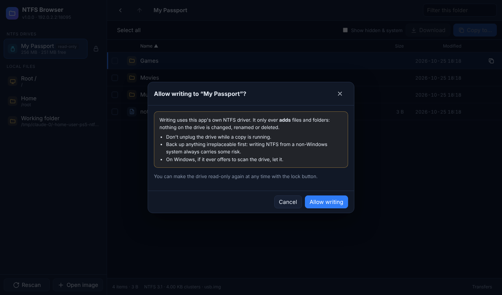

# NTFS Browser for PS5

A file browser payload for jailbroken PS5 consoles that can **read and write
NTFS drives**. The PS5 only understands exFAT and FAT32, so an NTFS-formatted
USB drive normally shows up as unusable. This payload includes its own NTFS
driver, so you can browse such a drive, preview files, copy files from it onto
the console, and copy files from the console onto it, without reformatting.

It runs as a small web server on the console. The interface opens in the PS5's
own browser (controller friendly), and you can also open it from a phone or PC
on the same network.

```
http://<ps5-ip>:8085
```



## Features

- **Finds NTFS drives automatically**, including drives plugged in while it
  runs. Handles MBR (including logical partitions), GPT and unpartitioned
  drives. You can also open raw `.img` disk images.
- **Browse** with breadcrumbs, filter-as-you-type, sorting, and a list that
  stays fast with tens of thousands of files.
- **Previews**: images, video and audio (streamed, with seeking), text in
  UTF-8 and UTF-16, and a hex view for binary files.
- **Copy both ways**: copy files or whole folders from the NTFS drive to
  internal storage (`/data/...`) or an exFAT USB drive, **or from the console
  onto the NTFS drive** (e.g. backups, saves, dumps). Copies run in the
  background with progress, speed and time remaining, and can be cancelled.
  Free space is checked before starting, and an interrupted copy picks up
  where it stopped when you start it again.
  

- **Write safely**: NTFS drives start **read-only**. Writing is switched on per
  drive with the lock button, and it is refused on drives Windows didn't
  unmount cleanly (see [Writing to NTFS](#writing-to-ntfs)).
- **New folder** on the console or on a writable NTFS drive.
- **Download** files to a phone or PC through the browser.

  

- **Also browses the console's own file system** (`/data`, `/mnt/usb0`, ...).
- **Controller and keyboard navigation** (see below).

### NTFS support

| | |
|---|---|
| NTFS 3.0 / 3.1 (Windows XP – 11) | ✅ |
| Cluster sizes 512 B – 2 MB | ✅ |
| Huge, fragmented files (`$ATTRIBUTE_LIST`) | ✅ |
| Big folders (multi-level directory B-trees) | ✅ |
| Compressed files (LZNT1, "Compress contents to save disk space") | ✅ |
| Sparse files | ✅ |
| Unicode names, including emoji | ✅ |
| Case-insensitive paths, hard links | ✅ |
| Volumes not cleanly unmounted / hibernated by Windows Fast Startup | ✅ read-only, flagged as "dirty" |
| Encrypted files (EFS) | ❌ listed, but contents can't be read |
| Symlinks / junctions | shown, not followed |
| Alternate data streams | ignored (main stream only) |
| Creating files and folders on NTFS | ✅ opt-in per drive |
| Changing, renaming or deleting existing NTFS files | ❌ by design (use a PC) |

If Windows wasn't shut down cleanly, the most recent changes may still be in
the NTFS journal and won't be visible. Use "Safely remove" on Windows before
unplugging.

### Writing to NTFS

Writing is **off until you turn it on** for a drive (the lock button next to
it, or *Allow writing* in the copy dialog). The writer only ever **adds**
files and folders: it never changes, renames or deletes anything that is
already on the drive, so the worst an interruption (say, the drive being
unplugged mid-copy) can do is leave a partly copied file and a few unused
clusters, which Windows' `chkdsk` tidies up. Start the same copy again and it
continues where it stopped.

Writing is refused when the drive isn't in a clean state, because Windows
would otherwise replay its journal over the new data:

- the volume is marked dirty (Windows crashed or the drive was pulled out),
- Windows is hibernated on it (Fast Startup), or
- the NTFS journal has unsaved changes.

Plug the drive into Windows and use *Safely remove* (or shut Windows down
fully) to fix that.



New files and folders use the same on-disk layout as ntfs-3g, the Linux NTFS
driver Windows has accepted for many years. Names that Windows can't
represent (`\ : * ? " < > |`, trailing dots, `CON`, ...) are adjusted
automatically. Files and folders become readable and writable by everyone.

> **Back up anything irreplaceable first.** The writer is tested heavily (see
> [Tests](#tests)), but it has not yet been tested by running Windows `chkdsk`
> on drives it has written. Writing NTFS from a non-Windows system always
> carries some risk.

## Requirements

- A PS5 running an exploit with an **ELF loader**, for example
  [elfldr](https://github.com/ps5-payload-dev/elfldr) on port 9021 or
  etaHEN's payload loader. Firmware support depends on your exploit chain, not
  on this payload.
- A USB drive formatted as NTFS.

## Install and run

1. Get `ntfs-browser.elf` from the
   [latest release](https://github.com/abcde6543/PS5-NTFS-BROWSER/releases/latest)
   (or build it as described below).
2. Run your jailbreak so the ELF loader is listening.
3. Send the payload, using one of these:
   ```sh
   # with the PS5 payload SDK
   make deploy PS5_HOST=192.168.1.50
   # or with netcat / socat
   nc -q0 192.168.1.50 9021 < ntfs-browser.elf
   socat -u FILE:ntfs-browser.elf TCP:192.168.1.50:9021
   ```
   With etaHEN you can also put the file in its payload folder and launch it
   from the etaHEN menu.
4. A notification shows the address, and the PS5 browser opens on the file
   browser. Plug in the NTFS drive; it appears in the sidebar within about
   3 seconds.

Sending the payload again while it's already running just reopens the
browser.

### Controls

| Controller | Keyboard | Action |
|---|---|---|
| D-pad ↑ ↓ / left stick | ↑ ↓ | Move |
| ✕ | Enter / → | Open folder or preview file |
| ○ | Backspace / ← | Parent folder (closes dialogs) |
| □ | Space | Select / deselect |
| △ | C | Copy selection to PS5 |
| L1 / R1 | Page Up / Down | Page up / down |
| | `/` | Filter |

In the PS5 browser, the controller usually drives a pointer, so you can always
click as well. The gamepad mappings work where the browser exposes the
Gamepad API.

> **Downloads on the console:** the PS5 browser can't save files. On the
> console, use **Copy to…**; use **Download** from a phone or PC.

## Building

### PS5 payload

Install the [PS5 payload SDK](https://github.com/ps5-payload-dev/sdk) (needs
`clang` and `lld` 18+), either from its release zip or from source:

```sh
git clone https://github.com/ps5-payload-dev/sdk.git
cd sdk && sudo make DESTDIR=/opt/ps5-payload-sdk install
```

Then:

```sh
make                                  # -> ntfs-browser.elf
make PS5_PAYLOAD_SDK=/path/to/sdk     # SDK elsewhere
make PORT=9090                        # different HTTP port (default 8085)
make LAUNCH_BROWSER=0                 # don't open the PS5 browser on start
```

### Making a release

Push a version tag and GitHub Actions builds the payload from source and
publishes the release, with notes from `docs/releases/<tag>.md`:

```sh
git tag v1.1.0 && git push origin v1.1.0
```

### Desktop build (for development)

The same code builds on Linux, macOS and FreeBSD. It serves the same UI and
reads NTFS images or devices you pass on the command line:

```sh
make host
./build/ntfs-browser -p 8085 my-ntfs.img /dev/sdb   # then open http://localhost:8085
./build/ntfstool ls   my-ntfs.img /some/folder
./build/ntfstool cat  my-ntfs.img /some/file.txt
./build/ntfstool tree my-ntfs.img
./build/ntfstool info my-ntfs.img
./build/ntfstool check my-ntfs.img                     # consistency check
./build/ntfstool mkdir  my-ntfs.img /new/folder        # writes!
./build/ntfstool put    my-ntfs.img local.bin /dir/local.bin
./build/ntfstool putdir my-ntfs.img ./local-dir /dir/copy
```

### Tests

```sh
sudo make test     # Linux; needs ntfs-3g, attr (setfattr), python3 and /dev/fuse
```

- `tests/run_tests.py` builds NTFS images with `mkntfs`, fills them through
  `ntfs-3g` with the awkward cases (6,000-file folders, files fragmented across
  13 MFT records, compressed and sparse files, Unicode and case-only name
  differences, hard links, 512 B / 1 KB / 64 KB clusters, MBR / GPT / logical
  partitions). It then checks that this driver lists the same tree and returns
  byte-identical contents for every file. Runs under AddressSanitizer and UBSan.
- `tests/fuzz.py` corrupts NTFS metadata at random (300 images) and checks
  that damaged drives produce errors, never crashes, hangs or leaks.
- `tests/write_tests.py` stresses the NTFS **writer**: every cluster size
  from 512 B to 64 KB, 5,000 files in one folder (deep index B-trees), Unicode
  and very long names, badly fragmented free space, file-table growth, a full
  disk, and eight rounds alternating with ntfs-3g. Every result is judged by
  three independent checks: a structural checker (`ntfstool check`: cluster
  accounting, MFT bitmap, index order, links), `ntfsresize --check`, and
  ntfs-3g, which must read back every file by name byte for byte and then
  modify the same folders itself.
- `tests/test_server.py` exercises the HTTP API end to end: listing,
  downloads, byte ranges, keep-alive, 16 parallel streams, copy jobs in both
  directions, resume after cancel, write protection, refusing dirty drives,
  mount and unmount, and the security checks.

## How it works

```
src/
  main.c       start-up, notifications, hot-plug thread
  http.c       small HTTP/1.1 server (keep-alive, ranges, thread per client)
  api.c        JSON API + file streaming
  vfs.c        one view over console storage and NTFS volumes; device scanning
  jobs.c       background copy queue
  ntfs.c       the NTFS reader
  ntfs_write.c the NTFS writer (allocation, MFT growth, index B-tree insert)
  part.c       MBR / GPT partition tables
  bdev.c       sector-aligned raw device access with a read cache
  utf.c        UTF-16 <-> UTF-8
  platform.c   PS5 specifics (notifications, opening the browser, IP address)
web/index.html the whole UI, embedded into the payload at build time
```

USB drives appear on the PS5 as FreeBSD `da` devices (`/dev/da0`, ...). The
payload opens the device read-only, finds the partitions, and reads NTFS
structures directly: boot sector → `$MFT` → MFT records (with update-sequence
fixups) → attributes → data runs. Raw disk devices only allow reads at
sector-aligned offsets and lengths, so `bdev.c` rounds every read to the
sector size and keeps an 8 MB block cache. When you allow writing, the device
is reopened read-write; partial-sector writes are read-modify-written.

### API

All responses are JSON unless noted. Requests that change something must be
`POST` and carry an `X-NTFSB: 1` header.

| Method | Path | Parameters |
|---|---|---|
| GET | `/api/status` | |
| GET | `/api/volumes` | |
| GET | `/api/volinfo` | `vol` |
| GET | `/api/list` | `vol`, `path` |
| GET/HEAD | `/api/file` (raw bytes, supports `Range`) | `vol`, `path`, `dl=1` to download |
| POST | `/api/copy` | `vol`, `path`, `dvol` (destination drive, default `ps5`), `dest` |
| POST | `/api/writable` | `vol`, `on=1` / `on=0` |
| GET | `/api/jobs` | |
| POST | `/api/jobs/cancel` | `id` |
| POST | `/api/jobs/clear` | |
| POST | `/api/rescan`, `/api/mount` (`path`), `/api/unmount` (`vol`), `/api/mkdir` (`vol`, `path`) | |

`vol` is `ps5` for the console's own file system, or the `id` of an NTFS
volume from `/api/volumes`.

## Security

While it runs, **anyone on your local network can browse the console's files
and the NTFS drive, and start copies onto the console** (and onto NTFS drives
you have made writable). This is the same as FTP payloads. The server never
deletes anything, and only overwrites partly copied files inside the copy
destination you choose. State-changing requests need a custom
header, so other websites open in the PS5 browser can't trigger them. HTML and
SVG files from the drive are served as plain text so they can't run scripts.
Stop the payload, or reboot, when you're done, and don't expose port 8085 to
the internet.

## Troubleshooting

- **Drive not listed.** Press **Rescan**. Check that the drive is NTFS and
  not BitLocker-encrypted. If your console names USB devices differently, use
  **Open image** with the device path (for example `/dev/da0`); browse `/dev`
  under *Root /* to find it. Some USB hubs and enclosures need a moment after
  plugging in, so the app retries several times.
- **"Volume is dirty" / writing refused.** Windows didn't unmount it cleanly,
  or Fast Startup hibernated it. Browsing and copying *from* the drive work;
  to write to it, plug it into Windows and use *Safely remove* (or run
  `chkdsk`, or shut Windows down fully instead of using Fast Startup).
- **"Too fragmented" when copying to NTFS.** Each new file has to fit its
  list of disk extents in one file record. On a badly fragmented drive, very
  large files can exceed that; defragment the drive on Windows, or copy the
  file to an empty drive.
- **"A different file already exists".** The destination already has a file
  with that name but a different size. The writer never replaces files; copy
  to another folder or delete it on a PC.
- **"Port 8085 already in use".** Another copy is running. Sending the payload
  again just reopens the browser.
- **Copy fails with "not enough space".** The total size of the selection is
  checked against free space in the destination before copying.

## License

GPL-3.0-or-later, the same as the PS5 payload SDK. See `LICENSE`.
